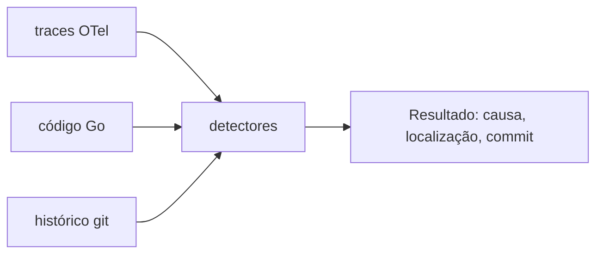

# Rootline

Rootline é uma ferramenta open source de análise de causa raiz de regressões de desempenho.
Dado um sintoma (um serviço e uma rota que pioraram entre duas versões), ela cruza os traces
OpenTelemetry, o código-fonte e o histórico do git, e aponta a causa (por exemplo, um N+1), a
função e a linha onde ela está e o commit que a introduziu.

## Como funciona



## Como rodar

Pré-requisitos: Go (versão do `go.mod`), git e, para gravar cenários, Docker.

Build e testes (a raiz, `hook/` e `demo-app/` são módulos separados):

```sh
CGO_ENABLED=0 go build ./...
go test ./...
(cd hook && GOWORK=off go test ./...)
(cd demo-app && GOWORK=off go test ./...)
```

Lint (golangci-lint v2.15.0, o mesmo do CI e do gate):

```sh
./scripts/check-no-spec-refs.sh
test -z "$(gofmt -l .)" && go vet ./...
golangci-lint run
(cd hook && GOWORK=off golangci-lint run)
(cd demo-app && GOWORK=off golangci-lint run)
```

Avaliação com o cenário `n1-basic`:

```sh
go build -o bin/rootline-eval ./cmd/rootline-eval
# gera o repositório de fixture e o gabarito
bin/rootline-eval generate --scenario eval/fixtures/scenarios/n1-basic --source . --out /tmp/n1-gen
# grava os traces (precisa de Docker: sobe Postgres, Collector e o demo-app)
bin/rootline-eval record --scenario eval/fixtures/scenarios/n1-basic --source . --out /tmp/n1-rec
# pontua só com detectores e compara com o placar (sai com 1 se houver regressão)
bin/rootline-eval score --recordings /tmp/n1-rec --placar eval/placar.json
```

## Placar atual

Modo só-detectores, igual ao `eval/placar.json`:

| Métrica | Resultado |
|---|---|
| Causa | 1/1, 100% |
| Linha | 1/1, 100% |
| Commit | 1/1, 100% |
| Estrito | 1/1, 100% |

Níveis da Linha: 1=1 2=0 ausente=0.

O projeto avança em slices verticais; decisões ficam em `docs/adr/`.
