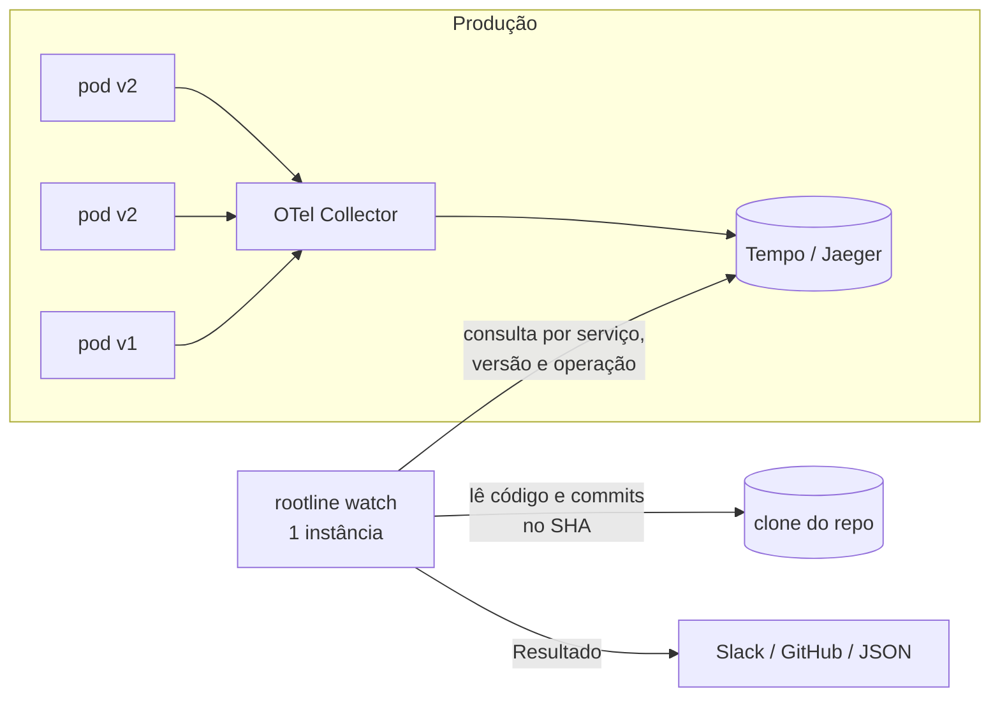
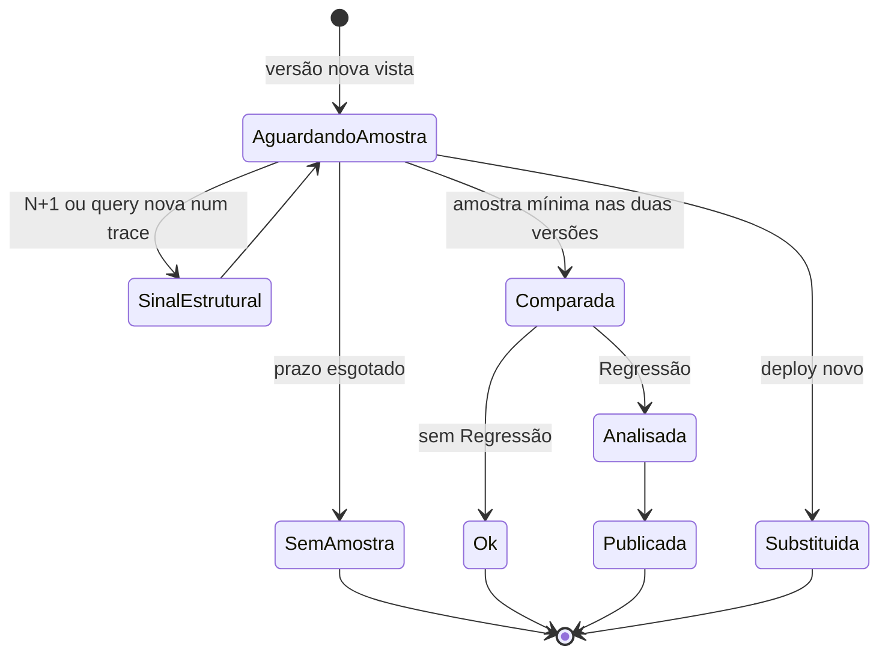

# Rootline automático por deploy

Este documento descreve a próxima grande mudança do Rootline: deixar de ser uma CLI que alguém roda
sobre um arquivo e passar a avisar sozinho, depois de um deploy, qual operação piorou, em que linha
e por qual commit. Ainda é uma proposta. As decisões que ela pede estão em
[Decisões que precisam de ADR](#decisões-que-precisam-de-adr) e passam pelo fluxo normal antes de
qualquer ticket.

## Onde o Rootline está hoje

O fluxo atual, descrito no [guia de instrumentação](guia-instrumentacao.md), é todo manual:

1. O serviço emite traces OpenTelemetry com o hook de chamador e `service.version` igual ao SHA.
2. O Collector grava um `traces.jsonl` com o exporter `file` ([ADR-0008](adr/0008-traces-em-arquivo-e-gravacao-separada-da-analise.md)).
3. Alguém grava as duas versões com a mesma carga, copia o arquivo e roda `rootline symptoms`.
4. A mesma pessoa roda o `rootline analyze` sugerido e lê o Resultado.

Isso serviu para construir e medir o motor (detectores, localização, correlação com commit, placar).
Para um time usar em produção, tem quatro problemas:

- **Alguém precisa lembrar de rodar.** Se ninguém desconfiar do deploy, ninguém roda.
- **O arquivo não escala.** Com o Collector como DaemonSet, cada nó grava o próprio arquivo, e a
  pessoa teria que juntá-los. O arquivo também cresce sem limite.
- **A janela é escolhida à mão.** A pessoa decide quanto tempo antes e depois do deploy entra na
  comparação.
- **A gravação exige carga igual.** Em produção não existe "aplicar a mesma carga"; existe o tráfego
  que veio.

## Caminhos descartados

### Rodar no CI

O CI não tem traces de produção. Para o Rootline rodar ali, o CI teria que subir a app, o banco e o
Collector, e aplicar carga nas duas versões. É o que o job `placar` já faz, e ele é lento. Serve
para medir o Rootline, não para usá-lo a cada deploy. Bloquear o deploy esperando essa gravação
seria pior: atrasa todo deploy por um risco que quase nunca se concretiza.

### Análise contínua sem troca de versão

Analisar qualquer lentidão a qualquer momento faz do Rootline um backend de observabilidade:
guardar traces, calcular baselines por horário e por tráfego, detectar anomalia no tempo. Já existem
produtos maduros nesse espaço (Datadog Watchdog, Honeycomb BubbleUp, Dynatrace), e o Rootline
perderia o que o diferencia, que é apontar **a função, a linha e o commit**. Isso só é possível
porque existe uma troca de versão para comparar. Uma lentidão sem deploy (pico de tráfego, lock,
nó ruim) não tem commit culpado, e o roadmap já registra que lock e CPU dependem de dados que o
trace não traz.

## A proposta

O Rootline passa a ter um modo serviço, `rootline watch`, com uma única instância por ambiente. Ele:

1. lê os traces do backend que o time já usa (Tempo ou Jaeger), e não de um arquivo;
2. percebe quando aparece um `service.version` novo;
3. acompanha cada operação de entrada da versão nova até ela juntar a amostra mínima;
4. compara essa operação com a versão anterior, usando a mesma regra de Regressão de hoje
   ([ADR-0032](adr/0032-regressao-com-p50-que-dobra.md));
5. quando há Regressão, roda o `analyze` dela;
6. publica o Resultado num destino configurado (stdout em JSON, Slack, comentário no GitHub).

O motor não muda: detectores, localização pelo hook e pelo `go/ast`, correlação com commit e
Verificações continuam os mesmos. Muda a entrada (de onde vêm os spans), o gatilho (quem decide
quando analisar) e a saída (para onde vai o Resultado).

### O exemplo completo

O serviço `pedidos-api` está na versão `4f1c9a2`. Às 14h sai o deploy `9b7d31c`, com três commits.
Um deles, `7e2a5f1`, coloca um N+1 em `internal/orders/service.go:42`, dentro de
`GET /customers/{id}/orders`.

| Hora | O que o watch vê | O que ele faz |
|---|---|---|
| 14h00 | Spans com `service.version = 9b7d31c` pela primeira vez | Registra a versão nova; a anterior com amostra é `4f1c9a2` |
| 14h02 | `GET /products` chega a 30 traces na versão nova | Compara com `4f1c9a2`: sem Regressão. Marca como ok |
| 14h15 | `POST /orders` chega a 30 traces | Sem Regressão. Marca como ok |
| 18h10 | Primeiro trace de `GET /customers/{id}/orders` | A mesma query aparece 24 vezes no loop. Publica o sinal antecipado (abaixo) |
| 18h40 | A operação chega a 30 traces | p50 de 8,4 para 61,2 ms: Regressão. Roda o `analyze` e publica a Causa |

A mensagem final diz o mesmo que o `analyze` diz hoje: N+1 em
`orders.(*Service).List`, `internal/orders/service.go:42`, commit `7e2a5f1`, com as evidências.

### Gatilho por amostra, não por tempo

Um timer fixo ("analise 30 minutos depois do deploy") falha com a operação que só é chamada horas
depois. O gatilho é por operação: ela é comparada quando a versão nova junta a amostra mínima
(hoje 30 traces). Cada operação tem seu próprio relógio.

Uma operação rara pode nunca chegar a 30 traces. Depois de um prazo configurável (sugestão: 48 h),
o watch publica um resumo com as operações que ficaram sem amostra para comparar, em vez de ficar
calado.

### Sinal estrutural antes da amostra

Há dois tipos de sinal, e eles pedem quantidades diferentes de dados:

- **Estrutural:** N+1, uma query nova, uma chamada nova. Aparece num trace só. O primeiro trace de
  `GET /customers/{id}/orders` já mostra a query de itens 24 vezes, com a linha vinda do hook.
- **Estatístico:** a operação ficou mais lenta. Precisa da amostra mínima nas duas versões, porque
  a latência varia muito entre requisições.

O watch pode publicar o sinal estrutural cedo, marcado como "ainda sem amostra para confirmar
lentidão", e depois confirmar ou retirar. Isso é uma decisão de produto: hoje um N+1 sem Regressão
sai com aviso ([ADR-0032](adr/0032-regressao-com-p50-que-dobra.md)), e o mínimo de traces do
detector de N+1 para esse uso precisa ser definido.

### Versão de referência

A referência é a versão anterior que tem a amostra mínima naquela operação, como na referência
implícita do [ADR-0005](adr/0005-contrato-do-sintoma-e-escolha-da-referencia.md). Ela não precisa
ser do mesmo horário. Duas consequências:

- **A retenção do backend tem que cobrir a referência.** Se o deploy anterior foi há três semanas e
  o backend guarda sete dias, a operação fica sem referência, e o watch diz isso.
- **Dois deploys seguidos.** Se `9b7d31c` for substituída antes de uma operação juntar amostra, a
  comparação passa a ser entre a última versão com amostra e a atual. A correlação já olha todos os
  commits entre os dois SHAs (`RevList`), então o commit culpado continua aparecendo.

### Canary

Com canary, as duas versões recebem tráfego ao mesmo tempo. É a comparação mais justa (mesmo horário,
mesma carga), e o ADR-0005 já prevê esse caso com `--bad-version`. No watch, quando duas versões
estão ativas juntas, a referência é a outra versão ativa.

### Vários pods e autoscaling

Nada é instalado por pod:

- O hook é uma biblioteca compilada no binário. Toda réplica criada pelo autoscaling sai da mesma
  imagem e já tem o hook.
- `service.version` vem de uma variável no Deployment, preenchida pelo CI. Todo pod herda o valor.
- O watch consulta o backend por serviço e versão e recebe os traces de todos os pods juntos. Mais
  pods só fazem a amostra chegar mais rápido.
- Num rolling deploy, pods das duas versões rodam juntos por alguns minutos. Cada span diz de qual
  versão veio.

Um problema de um pod só (um nó ruim) se dilui na média da versão. Se isso importar, o processor
`k8sattributes` do Collector pode anotar pod e nó, e o Rootline mostraria isso como evidência. Fica
fora desta proposta.

### Como o watch percebe o deploy

Duas formas, que podem coexistir:

1. **Pelos próprios traces (recomendada para começar).** O watch consulta periodicamente as versões
   presentes por serviço. Uma versão nova é um deploy. Não precisa de integração com o pipeline.
2. **Por evento.** O pipeline de deploy chama `rootline deploy-check --service X --version <sha>`
   (por exemplo, num job disparado pelo evento `deployment_status` do GitHub Actions). O job não
   bloqueia o deploy. Útil para quem não quer um processo rodando o tempo todo.

### O que o watch precisa ter acesso

- **Backend de traces**, só leitura.
- **Clone do repositório**, atualizado com `git fetch` antes de analisar uma versão nova. Uma
  deploy key só de leitura basta.
- **Destino de publicação** (webhook do Slack, token do GitHub com escopo mínimo).
- **Estado próprio:** quais versões e operações já foram comparadas e publicadas, para não publicar
  de novo depois de um reinício. Pode ser um arquivo pequeno num volume; não precisa de banco.

O watch nunca escreve no backend, no repositório nem no banco da aplicação.

## Ciclo de vida de uma operação numa versão nova

## Impacto no código

O domínio (`internal/trace`, `analysis`, `detector`, `correlation`, `evaluation`, `explain`)
continua só com a stdlib. As mudanças ficam nas portas, nos adapters e no `cmd/rootline`.

- **Porta `TraceSource`.** Hoje ela tem `Spans()`, que devolve todos os spans do arquivo. Um
  backend não devolve "tudo": a porta precisa aceitar uma consulta (serviço, versão, operação,
  janela, limite de traces). O adapter de arquivo continua existindo e filtra em memória, para o
  placar e a avaliação não mudarem.
- **Adapters novos de fonte:** `internal/adapter/tempo` e/ou `internal/adapter/jaeger`, cada um com
  teste de integração (testcontainers) e o mesmo contrato do adapter de arquivo.
- **Porta nova de publicação**, declarada por quem consome (o watch), com adapters para stdout em
  JSON, Slack e GitHub.
- **Comandos novos:** `rootline watch` (laço contínuo) e `rootline deploy-check` (uma passada). O
  `analyze` e o `symptoms` ganham a opção de ler do backend em vez do arquivo.
- **Carga desigual.** Hoje ela compara a quantidade de traces das duas gravações
  ([ADR-0030](adr/0030-regressao-symptoms-e-carga-desigual.md), mantida no ADR-0032). Com janelas de
  durações diferentes, a contagem bruta deixa de servir. Precisa passar a comparar taxa (traces por
  minuto) ou ser desligada fora do canary.
- **Limite de traces por versão.** Buscar milhares de traces completos no backend é caro. O watch
  busca uma amostra limitada por operação e versão (por exemplo, até 200), e o Resultado diz quantos
  usou.

## Decisões que precisam de ADR

1. **Fonte de traces por backend.** Substitui ou complementa o ADR-0008: Tempo, Jaeger ou os dois,
   formato da consulta, limite de traces e o que acontece quando o backend amostra.
2. **Modo watch e gatilho por amostra.** Quem detecta a versão nova, a regra do gatilho por operação,
   o prazo sem amostra e o estado persistido.
3. **Sinal estrutural antecipado.** Quando publicar uma Candidata antes da Regressão, com quantos
   traces e como retirar.
4. **Referência no modo watch.** Complementa o ADR-0005: versão anterior com amostra, canary e
   retenção.
5. **Carga desigual por taxa.** Revisa a regra do ADR-0032 para janelas de durações diferentes.
6. **Escrita em sistema externo.** O [brief](brief.md) deixa fora da v1 "qualquer escrita em
   sistemas externos". Publicar no Slack ou no GitHub é escrita. Essa linha do brief precisa mudar,
   restrita à publicação do Resultado.

## Riscos e perguntas em aberto

- **API do backend.** Quantos traces uma busca devolve, quanto custa buscar o trace completo e se dá
  para filtrar por `service.version` e `http.route` de forma eficiente. Precisa de um spike com o
  Tempo e com o Jaeger antes da ADR 1.
- **Amostragem.** Com head sampling de 10%, uma operação leva dez vezes mais tempo para juntar 30
  traces. Com tail sampling que guarda só os lentos, a comparação fica enviesada, e o watch precisa
  detectar isso e avisar.
- **Muito `Inconclusive` automático.** Na rodada 2 do
  [piloto](spikes/2026-11-24-piloto-apps-reais.md), o Rootline não deu falso positivo, mas não
  acertou nenhum dos sete apps, porque os problemas estavam fora dos detectores. Automatizar a
  entrega antes de ampliar a cobertura produz muitas mensagens sem causa. Mitigação: publicar só
  Resultados com Causa por padrão, e os `Inconclusive` com Regressão num resumo, e seguir em paralelo
  com os itens 5, 6 e 9 do [roadmap](roadmap.md).
- **Dados na mensagem.** A query normalizada usa `$1`, sem valores, mas nomes de tabela e de função
  vão para o Slack. O destino precisa ser um canal do próprio time.
- **Ruído.** Uma operação no limite da regra pode oscilar entre Regressão e não Regressão. O watch
  publica uma vez por versão e operação, e não a cada consulta.

## Plano em fatias

Cada fatia entrega algo usável e passa pelo gate. A ordem tira primeiro o risco maior (a API do
backend).

0. **Spike do backend.** Subir Tempo e Jaeger com o demo-app, gravar um cenário e medir quantos
   traces dá para buscar por versão e operação, e em quanto tempo. Sai uma nota em `docs/spikes/` e a
   ADR 1.
1. **`analyze` e `symptoms` lendo do backend.** Porta `TraceSource` com consulta, adapter do backend
   escolhido e a flag `--source`. Ainda manual, mas sem arquivo e sem juntar arquivos de vários
   Collectors.
2. **`rootline deploy-check`.** Uma passada: dada a versão nova, compara cada operação com amostra e
   imprime o Resultado em JSON. Já dá para rodar num job pós-deploy.
3. **`rootline watch`.** Laço contínuo, detecção da versão nova pelos traces, gatilho por amostra,
   prazo e estado persistido.
4. **Publicadores.** Slack e GitHub, atrás da porta de publicação.
5. **Sinal estrutural antecipado.**
6. **Canary.** Referência pela outra versão ativa.

Em paralelo, a cobertura de detectores do roadmap (sintoma de erro, hook para `database/sql`, modo
com LLM) continua, porque é ela que decide quantas mensagens trazem uma Causa.

## Como saber que deu certo

- **Zero passos manuais** entre o deploy e a mensagem, no demo-app rodando num cluster local (kind)
  com Tempo ou Jaeger.
- **Tempo até o aviso:** do momento em que a operação junta a amostra mínima até a mensagem
  publicada, medido e registrado.
- **O placar não piora.** Os mesmos cenários, lidos do backend em vez do arquivo, dão o mesmo
  Resultado. Falso positivo de detector e alucinação continuam em 0.
- **Uma rodada do piloto em modo watch**, com os apps do laboratório publicando sozinhos.

## Fora desta proposta

- Análise de lentidão sem troca de versão.
- Alerta de capacidade ou de SLO.
- Problema de um pod ou nó isolado.
- Correção automática, abertura de PR ou qualquer escrita além da publicação do Resultado.
- UI própria. A saída continua sendo texto, JSON e as mensagens nos destinos.
